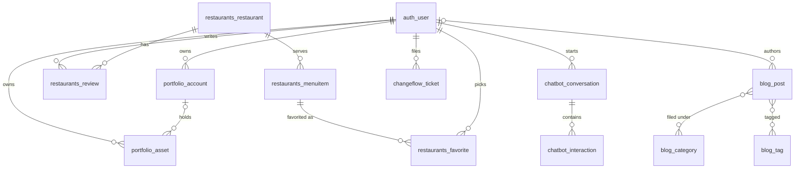
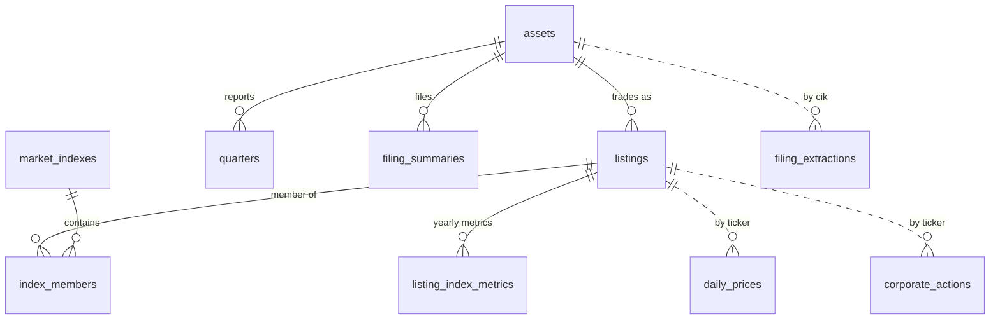

# Database Schema

One PostgreSQL server holds two databases, one per backend. They never join each other: nothing is a
foreign key across the line, and the only link is by value (a portfolio holding's `ticker` matches a
`listings.ticker` string).

| Database | Owner | Schema source of truth |
|----------|-------|------------------------|
| `postgres` | Django | `django/*/models.py` + `django/*/migrations/` |
| `springboot` | Spring Boot | Flyway `springboot/src/main/resources/db/migration/V*.sql` (Hibernate runs `ddl-auto=validate`, so the JPA entities must match) |

This file is hand-maintained. When a model or migration changes, update the matching section here.
If this file and the migrations disagree, the migrations win.

Conventions used below: **PK** primary key, **FK** foreign key, **UQ** unique, **NN** not null. Every
table has an `id bigint` PK unless noted.

---

## Django (`postgres` database)

Table names follow Django's `<app>_<model>` default; no model overrides `db_table`.

### Users and auth

`users` defines no models. Accounts are Django's built-in `auth_user` (username, email, password hash,
`is_staff`, `is_superuser`, ...), plus the standard `auth_*`, `django_admin_log`, `django_session`,
`django_content_type` and `django_migrations` tables. SimpleJWT tokens are stateless; no blacklist
table is installed.

### portfolio

**`portfolio_account`**: a brokerage account a user groups holdings under.

| Column | Type | Notes |
|--------|------|-------|
| `name` | varchar(255) | NN |
| `account_type` | varchar(20) | NN, default `OTHER`. One of `ROTH_IRA`, `TRADITIONAL_IRA`, `TAXABLE_ACCOUNT`, `ROTH_401K`, `TRADITIONAL_401K`, `OTHER` |
| `user_id` | bigint | FK `auth_user`, NN, cascade delete |

**`portfolio_asset`**: one holding (a lot) of a ticker.

| Column | Type | Notes |
|--------|------|-------|
| `ticker` | varchar(5) | NN. Matches `listings.ticker` in `springboot` by value only |
| `shares` | numeric(25,5) | NN |
| `buy_date` | date | NN |
| `sell_date` | date | Null while still held |
| `user_id` | bigint | FK `auth_user`, NN, cascade delete |
| `account_id` | bigint | FK `portfolio_account`, nullable, cascade delete |

### chatbot

**`chatbot_conversation`**: one advisor chat thread.

| Column | Type | Notes |
|--------|------|-------|
| `user_id` | bigint | FK `auth_user`, NN, cascade delete |
| `title` | varchar(100) | NN |
| `created_at` | timestamptz | NN, set on insert |
| `last_message_at` | timestamptz | NN. Bumped per new message (not on rename); list order is by this, newest first |

**`chatbot_interaction`**: one question/answer pair. Not history-tracked, so deleting a conversation
really removes its messages.

| Column | Type | Notes |
|--------|------|-------|
| `conversation_id` | bigint | FK `chatbot_conversation`, NN, cascade delete |
| `input_text` | text | NN |
| `output_text` | text | NN |
| `timestamp` | timestamptz | NN, set on insert. Ordered by `(timestamp, id)` |

### restaurants

**`restaurants_restaurant`**

| Column | Type | Notes |
|--------|------|-------|
| `yelp_id` | varchar(250) | NN, default `1` |
| `name` | varchar(250) | NN |
| `address` | text | NN |
| `city` | text | NN, default `NA` |
| `state` | text | NN, default `Nash` |
| `latitude`, `longitude` | numeric(25,8) | NN, default `1` |
| `categories` | text | NN, default `eat` |
| `stars` | numeric(2,1) | NN, 1 to 5 in 0.5 steps |
| `review_count` | integer | NN, default `0` |

**`restaurants_review`**

| Column | Type | Notes |
|--------|------|-------|
| `restaurant_id` | bigint | FK `restaurants_restaurant`, NN, cascade delete |
| `user_id` | bigint | FK `auth_user`, NN, cascade delete |
| `rating` | numeric(2,1) | NN, 1 to 5 in 0.5 steps |
| `comment` | text | Nullable |

**`restaurants_menuitem`**

| Column | Type | Notes |
|--------|------|-------|
| `restaurant_id` | bigint | FK `restaurants_restaurant`, NN, cascade delete |
| `name` | varchar(100) | NN |
| `description` | text | Nullable |
| `price` | numeric(10,2) | NN |

**`restaurants_favorite`**

| Column | Type | Notes |
|--------|------|-------|
| `menu_item_id` | bigint | FK `restaurants_menuitem`, NN, cascade delete |
| `user_id` | bigint | FK `auth_user`, NN, cascade delete |
| `comment` | text | Nullable |

### changeflow

**`changeflow_changerequest`**: changelog entry.

| Column | Type | Notes |
|--------|------|-------|
| `title` | varchar(255) | NN |
| `description`, `solution` | text | NN, may be blank |
| `status` | varchar(20) | NN, default `PENDING`. One of `PENDING`, `IN_PROGRESS`, `COMPLETED`, `FAILED` |
| `priority` | varchar(20) | NN, default `MEDIUM`. One of `LOW`, `MEDIUM`, `HIGH`, `CRITICAL` |
| `data` | jsonb | NN, default `{}` |
| `created_at`, `updated_at` | timestamptz | NN, auto-set |

**`changeflow_ticket`**: user feedback ticket.

| Column | Type | Notes |
|--------|------|-------|
| `title` | varchar(255) | NN |
| `description` | text | NN |
| `status` | varchar(20) | NN, default `OPEN`. One of `OPEN`, `IN_REVIEW`, `CLOSED` |
| `user_id` | bigint | FK `auth_user`, NN, cascade delete |
| `created_at`, `updated_at` | timestamptz | NN, auto-set |

### blog

Rows are synced from the Markdown files in `django/blog/journal/` and `django/blog/learning-topics/`
by `manage.py sync_blog_posts`; the files are the source of truth.

**`blog_category`**, **`blog_tag`**: same shape.

| Column | Type | Notes |
|--------|------|-------|
| `name` | varchar(120) | NN, UQ |
| `slug` | varchar(140) | NN, UQ, indexed. Derived from `name` if blank |

**`blog_post`**

| Column | Type | Notes |
|--------|------|-------|
| `title` | varchar(220) | NN |
| `slug` | varchar(240) | NN, UQ, indexed |
| `excerpt` | text | NN, default `''` |
| `body_markdown` | text | NN |
| `cover_image_url` | varchar(200) | NN, default `''` |
| `published_at` | timestamptz | Nullable, indexed. Public = not null and in the past |
| `created_at` | timestamptz | NN, indexed, set on insert |
| `updated_at` | timestamptz | NN, auto-set |
| `author_id` | bigint | FK `auth_user`, nullable, set null on delete |

Join tables `blog_post_categories (post_id, category_id)` and `blog_post_tags (post_id, tag_id)`,
each UQ on the pair.

### entertainment

**`entertainment_recommendation`**

| Column | Type | Notes |
|--------|------|-------|
| `type` | varchar(10) | NN. One of `BOOK`, `MOVIE`, `SHOW`, `MUSIC`, `PODCAST`, `GAME`, `WEBSITE` |
| `title` | varchar(200) | NN |
| `artist` | varchar(200) | NN. Author, director, band, etc. |
| `notes` | text | NN, may be blank |
| `year` | smallint | Nullable, non-negative |
| `created_at` | timestamptz | NN, set on insert |

UQ `uniq_recommendation (type, title, artist)`.

### History tables (django-simple-history)

These models get a `<app>_historical<model>` shadow table:
`portfolio_account`, `portfolio_asset`, `restaurants_restaurant`, `restaurants_review`,
`restaurants_menuitem`, `restaurants_favorite`, `changeflow_changerequest`, `changeflow_ticket`.
Each copies the model's columns (FKs become plain `*_id` columns, no constraint) and adds `history_id`
(PK), `history_date`, `history_type` (`+` create, `~` update, `-` delete), `history_change_reason`
and `history_user_id`. Chatbot, blog and entertainment tables are not history-tracked.

---

## Spring Boot (`springboot` database)

Dotted lines are joins by value (`ticker` or `cik`), not foreign keys: prices and corporate actions
are keyed by ticker so the IEX universe (most symbols have no SEC asset) can load without a listing.

### Securities

**`assets`**: one SEC registrant (company or fund).

| Column | Type | Notes |
|--------|------|-------|
| `cik` | bigint | NN, UQ. SEC Central Index Key |
| `is_fund` | boolean | |

**`listings`**: one ticker. Several listings can share an asset (share classes, fund series).

| Column | Type | Notes |
|--------|------|-------|
| `ticker` | varchar(10) | NN, UQ |
| `title` | varchar(100) | NN |
| `asset_id` | bigint | FK `assets`, nullable |
| `sec_series_id`, `sec_class_contract_id` | varchar(32) | ETF/fund identity from SEC |
| `sec_series_name`, `sec_class_name` | varchar(255) | |
| `sec_class_ticker` | varchar(16) | |
| `sec_identity_status` | varchar(24) | ETF identity enrichment outcome |
| `last_sec_detection_at` | timestamp | Last corporate-action detection run (V2). Drives the rolling ~weekly re-detect. Not audited |

### Prices and corporate actions

**`daily_prices`**: one OHLCV bar per ticker per day, from IEX HIST. PK id comes from a sequence
allocated in blocks of 50 (batch inserts), not an identity column.

| Column | Type | Notes |
|--------|------|-------|
| `ticker` | varchar(10) | NN |
| `trade_date` | date | NN |
| `open_price`, `high_price`, `low_price`, `close_price` | double | Raw IEX prices |
| `adjusted_open`, `adjusted_high`, `adjusted_low`, `adjusted_close` | double | Split/dividend adjusted. Null until adjustment runs |
| `volume` | bigint | |

UQ `(ticker, trade_date)`.

**`corporate_actions`**: splits and dividends.

| Column | Type | Notes |
|--------|------|-------|
| `ticker` | varchar(10) | NN |
| `action_type` | varchar(10) | NN. `SPLIT` or `DIVIDEND` |
| `effective_date` | date | NN. Ex-date |
| `ratio` | double | NN. SPLIT: old shares / new shares (0.25 for a 4:1 forward split). DIVIDEND: per-share cash amount |
| `raw_dividend`, `adjusted_dividend` | double | Dividends only |
| `record_date`, `pay_date` | date | |
| `ex_date_source` | varchar(24) | How the ex-date was derived (V3). Dividends: `TUPLE_MATCHED`, `DIRECT_EX_TEXT`, `RECORD_DP`, `SYNTHETIC`, `PRICE_INFERRED`. Splits: `PRICE_BREAK`, `FILING_TEXT`, `SHARE_FACT`. Plain string, no check constraint |
| `source_type` | varchar(32) | One of `SEC_EQUITY_XBRL`, `SEC_ETF_FILING`, `SEC_PRICE_CORROBORATED`, `MANUAL`, `OTHER` |
| `confidence_score` | double | |
| `accession_number` | varchar(40) | Source SEC filing |
| `form_type` | varchar(20) | |
| `sec_series_id`, `sec_class_contract_id` | varchar(32) | ETF identity at detection time |

UQ `(ticker, action_type, effective_date, ratio)`.

**`filing_extractions`**: per-filing cache of text-extraction results (V4). SEC filings are
immutable, so each accession is parsed once per extractor version. Not audited.

| Column | Type | Notes |
|--------|------|-------|
| `cik` | bigint | NN |
| `accession_number` | varchar(40) | NN |
| `filing_date` | date | |
| `form_type` | varchar(20) | |
| `dividend_extractor_version`, `split_extractor_version` | integer | Re-extract when the code's version is newer |
| `best_record_date`, `best_record_date_score` | date, integer | |
| `ex_date_candidates_json`, `declarations_json` | text | JSON payloads |
| `best_split_date`, `best_split_date_score` | date, integer | |
| `extracted_at` | timestamp | |

UQ `(cik, accession_number)`.

### Fundamentals

**`quarters`**: one fiscal quarter of SEC XBRL financials per asset. Monetary columns are whole USD.

| Column | Type | Notes |
|--------|------|-------|
| `asset_id` | bigint | FK `assets` |
| `year`, `quarter` | integer | |
| `period_start`, `period_end` | date | |
| `revenues`, `gross_profit`, `operating_income_loss`, `net_income_loss` | bigint | Income statement |
| `assets`, `liabilities`, `stockholders_equity`, `cash_and_cash_equivalents_at_carrying_value`, `accounts_receivable_net_current`, `inventory_net` | bigint | Balance sheet |
| `net_cash_provided_by_used_in_operating_activities`, `payments_of_dividends`, `payments_for_repurchase_of_common_stock` | bigint | Cash flow |
| `earnings_per_share_basic`, `earnings_per_share_diluted` | double | |

UQ `(asset_id, year, quarter)`.

**`filing_summaries`**: LLM-generated 10-K summaries.

| Column | Type | Notes |
|--------|------|-------|
| `asset_id` | bigint | FK `assets`, NN |
| `ticker` | varchar(10) | NN |
| `accession_number` | varchar(30) | NN, UQ |
| `filing_date` | date | NN |
| `raw_text`, `summary` | text | |
| `created_at` | timestamp | NN |

### Indexes

**`market_indexes`**

| Column | Type | Notes |
|--------|------|-------|
| `code` | varchar(64) | NN, UQ. e.g. `FAT1000` |
| `display_name` | varchar(500) | NN, UQ |

**`index_members`**: a listing's weight in an index.

| Column | Type | Notes |
|--------|------|-------|
| `market_index_id` | bigint | FK `market_indexes`, NN |
| `listing_id` | bigint | FK `listings`, NN |
| `percent` | numeric(38,5) | NN. Weight |
| `outlier` | boolean | NN |
| `notes` | varchar(100000) | |

**`listing_index_metrics`**: yearly per-listing inputs to index construction.

| Column | Type | Notes |
|--------|------|-------|
| `listing_id` | bigint | FK `listings`, NN |
| `year` | integer | NN |
| `market_cap`, `free_float`, `free_float_market_cap`, `volume`, `volume_usd` | numeric(38,5) | |
| `year_ipo` | integer | |
| `price_date` | date | Trade date of the close behind `market_cap`. The rebuild skips rows priced more than 7 days before the newest row (V5) |
| `security_type`, `country_hq`, `country_incorp`, `state_hq`, `state_incorp` | varchar(1000) | |

UQ `(listing_id, year)`.

### Audit tables (Hibernate Envers)

Every entity table above except `filing_extractions` has a `<table>_aud` twin with the same columns
(all nullable, no FKs to data tables) plus `rev` (FK `revinfo`) and `revtype` (0 insert, 1 update,
2 delete), PK `(rev, id)`. `listings.last_sec_detection_at` is deliberately not audited.

**`revinfo`**: one row per Envers revision. `rev integer` PK, `revtstmp bigint` (epoch millis).

Flyway also keeps its own `flyway_schema_history` table.
